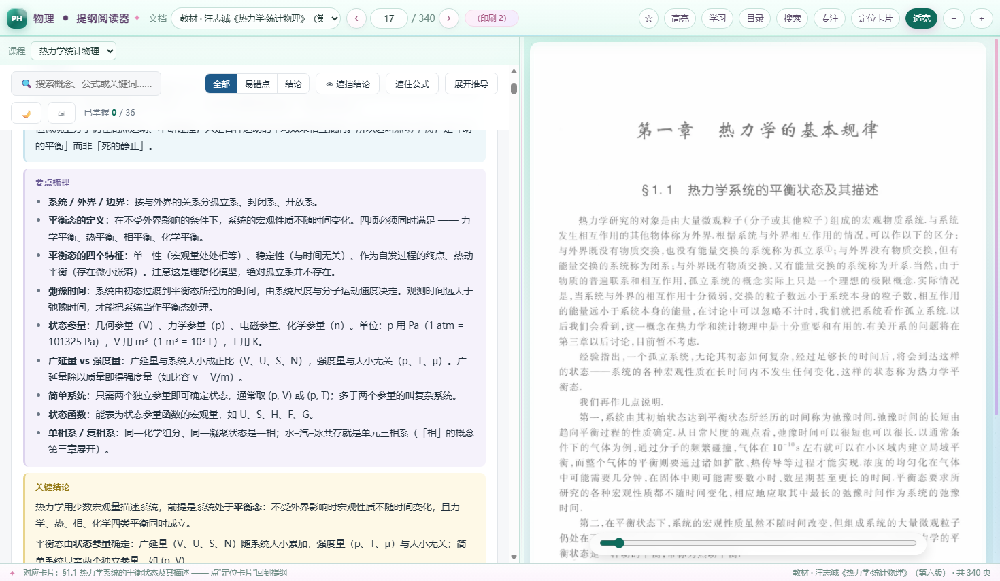

# 物理复习提纲阅读器

[](https://thunderauthur-source.github.io/physics-review-reader/)
[](https://github.com/thunderauthur-source/physics-review-reader/releases/tag/v1.0)
[](https://github.com/thunderauthur-source/physics-review-reader)

> 把「复习提纲」「教材」「课堂讲义」「习题解答」放在同一个窗口里的离线 / 网页阅读器。
> 左侧点提纲卡片，右侧直接跳到对应页；支持教材与讲义双链接、反向定位、搜索、书签、笔记和框选高亮。

[**在线使用**](https://thunderauthur-source.github.io/physics-review-reader/) · [**下载 Windows 安装版**](https://github.com/thunderauthur-source/physics-review-reader/releases/tag/v1.0) · [**问题反馈**](https://github.com/thunderauthur-source/physics-review-reader/issues)

> 如果这个项目帮你省了时间，欢迎在仓库右上角点一个 ⭐ Star，或把网页版链接发给需要的同学。

<p align="center">
  
  
</p>

## 目录

- [项目简介](#项目简介)
- [功能](#功能)
- [数据规模](#数据规模)
- [快速开始](#快速开始)
- [使用指南](#使用指南)
- [快捷键](#快捷键)
- [技术实现](#技术实现)
- [目录结构](#目录结构)
- [构建与维护](#构建与维护)
- [部署](#部署)
- [已知限制](#已知限制)
- [常见问题](#常见问题)
- [版本](#版本)
- [版权声明](#版权声明)

## 项目简介

这是一个为期末复习做的双课程阅读器，把两门课的提纲和原始资料绑定在一起：

- **量子力学**：格里菲斯《量子力学概论》教材、习题解答、19 份课堂课件
- **热力学统计物理**：汪志诚《热力学·统计物理》第六版教材、3 份课堂讲义

提纲里的每个知识点不再只是文字，而是带页码定位的卡片：

```
§2.2 麦克斯韦关系的简单应用
教材 pp.43–45 · 讲义 pp.14–20
```

点「教材」跳教材，点「讲义」跳课堂讲义；从教材/讲义的任意一页也能点「定位卡片」回到提纲。

项目同时提供三种形态：

| 形态 | 入口 | 适合 |
|---|---|---|
| 在线网页版 | [thunderauthur-source.github.io/physics-review-reader](https://thunderauthur-source.github.io/physics-review-reader/) | 发给同学，输入网址直接用 |
| Windows 安装版 | [Releases](https://github.com/thunderauthur-source/physics-review-reader/releases/tag/v1.0) | 本机离线使用，Edge 应用窗口 |
| 源码 / 静态站 | 本仓库 | 自己改提纲、换资料、部署到别的平台 |

## 功能

- **双课程切换**：量子力学 / 热力学统计物理，界面主题跟着切换（粉紫 / 青绿）
- **教材 + 讲义双链接**：热统 36 张卡片全部带教材页码，33 张同时带讲义页码
- **反向定位**：翻到教材/讲义某页，自动匹配提纲卡片；点「定位卡片」滚到对应位置并高亮
- **量子力学细粒度链接**：卡片、式号、图号、习题号都能跳页；111 道习题有解答页映射
- **全局搜索**：跨两门课搜标题、概念、公式，结果直接跳文档 + 页码 + 卡片
- **章节目录**：按文档分组，教材 36 节 + 三份讲义各节，共 69 条
- **书签 / 笔记 / 高亮**：按「课程 + 文档 + 页码」保存；高亮是图片上的框选，缩放后位置不跑
- **阅读体验**：页码滑杆、适宽/缩放、专注模式、分栏宽度记忆、上次课程记忆
- **学习数据**：导出当前页 PNG、备份/恢复 JSON（进度、书签、笔记、高亮、布局）
- **完全离线**：不联网、不占端口、没有后端；在线版也只是静态文件

## 数据规模

| 课程 | 文档 | 页数 | 提纲卡片 |
|---|---|---|---|
| 量子力学 | 教材 1 + 习题解答 1 + 课件 19 | 977 | 20 |
| 热力学统计物理 | 教材 1 + 讲义 3 | 559 | 36 |
| **合计** | **25** | **1536** | **56** |

页面图统一为 WebP：宽 1050–1400 px，合计约 137 MB；在线版按需加载，打开一页只取当前页和前后各一页。

页码偏移（PDF 页 → 印刷页）：

| 文档 | 偏移 | 换算 |
|---|---|---|
| 量子力学教材 | 12 | 印刷页 = PDF 页 − 12 |
| 量子力学题解 | 6 | 印刷页 = PDF 页 − 6 |
| 热统教材 | 15 | 印刷页 = PDF 页 − 15 |
| 所有课件 / 讲义 | 0 | PDF 页即页码 |

## 快速开始

### 在线网页版

直接打开：

```
https://thunderauthur-source.github.io/physics-review-reader/
```

不需要注册、不需要下载。进度和书签存在**当前浏览器**的 localStorage 里。

### Windows 安装版

从 [Releases](https://github.com/thunderauthur-source/physics-review-reader/releases/tag/v1.0) 下载：

```
PhysicsReader_v1.0_Installer.exe
```

首次运行会弹出「选择安装位置」：

- 默认 `D:\物理复习提纲阅读器`（没有 D 盘时默认“文档”）
- 可以点「浏览…」换任意文件夹
- 安装后自动创建桌面快捷方式，以后双击直接启动

要求：Windows 10/11、系统里有 Microsoft Edge、首次安装约 200 MB 空闲空间。
exe 没有代码签名，SmartScreen 提示时点「更多信息 → 仍要运行」。

### 本地网页版

```bash
cd 发布/网页版
python -m http.server 8080 --bind 127.0.0.1
# 浏览器打开 http://127.0.0.1:8080/
```

也可以双击 `发布/网页版/index.html` 直接打开，但 `file://` 下「导出当前页 PNG」会受 canvas 限制，完整功能建议走 HTTP。

## 使用指南

### 课程与文档

左侧顶部「课程」下拉切换两门课；「文档」下拉切换教材、题解、课件、讲义。
两门课分别记住上次的文档和页码，切换回来会恢复原位。

### 卡片跳转

每张卡片下方是页码链接：

```
教材 pp.43–45  ·  讲义 pp.14–20
```

- 点「教材」→ 右侧跳到教材对应页
- 点「讲义」→ 跳到课堂讲义对应页
- 热统 §2.8、§3.6、§3.8 是补充材料，讲义没有对应页，但教材链接仍然可用
- 量子力学的式号/图号/习题号链接也是同一套机制

### 反向定位

右侧翻到某页后，状态栏会显示「对应卡片：§x.y …」。
点顶栏「定位卡片」或直接点状态栏文字，左侧会滚到该卡片并高亮。

### 搜索、目录、滑杆

- **搜索**：跨两门课搜索 56 张卡片的标题、概念和正文，点结果直接跳页
- **目录**：按文档列出全部小节，点击跳页；热统同时列教材和讲义
- **滑杆**：右侧底部拖动，快速翻长文档
- **专注**：隐藏左侧提纲，全屏看图

### 书签、笔记、高亮

- 顶栏 `☆` 收藏当前页，「学习」抽屉查看/跳转
- 「笔记」按页保存，可导出/备份
- 「高亮」进入框选模式，在页面上拖框；点击已有高亮删除
- 数据保存在浏览器 localStorage（网页版）或 `程序\edgeprofile`（安装版）

### 进度与备份

「学习」→「统计」：

- 查看书签、笔记、高亮、已访问页数
- 导出当前页 PNG
- 备份/恢复学习数据 JSON

## 快捷键

| 按键 | 功能 |
|---|---|
| `←` / `→` | 上一页 / 下一页 |
| `Ctrl+1` / `Ctrl+2` | 切量子力学 / 热统 |
| `[` / `]` | 上一份 / 下一份文档 |
| `G` | 跳到指定页 |
| `+` / `-` / `0` | 放大 / 缩小 / 适宽 |
| `B` | 收藏当前页 |
| `H` | 框选高亮 |
| `N` | 打开笔记 |
| `T` | 章节目录 |
| `F` | 专注模式 |
| `/` 或 `Ctrl+K` | 全局搜索 |
| `Esc` | 关闭面板 / 退出高亮 |

## 技术实现

### 架构

```
┌─────────────────────────────────────────────────┐
│ index.html 顶栏 / 文档选择 / 页码 / 学习抽屉      │
│  ├─ iframe: outline_qm.html / outline_thermo.html│
│  │    └─ 卡片、搜索、折叠、暗色切换               │
│  └─ 右侧: pageImg（WebP）+ 高亮层 + 滑杆          │
└─────────────────────────────────────────────────┘
        ▲ postMessage                    ▲ localStorage
        │ open-doc / reveal-card         │ 进度/书签/笔记/高亮/布局
```

- 纯 HTML/CSS/JavaScript，无框架、无构建步骤、无后端
- 提纲在 iframe 里，父页面通过 `postMessage` 通信
- 页面图按 `docs/pages/<docId>/p%04d.webp` 命名
- 文档、卡片、习题映射都在 `data/manifest_*.json` 和 `data/search_index.js`

### 数据结构

文档：

```json
{
  "id": "thermo-book",
  "kind": "book",
  "title": "教材 · 汪志诚《热力学·统计物理》（第六版）",
  "pages": 340,
  "offset": 15,
  "pageDir": "docs/pages/thermo-book",
  "pagePattern": "p%04d.webp"
}
```

卡片（热统同时带教材和讲义）：

```json
{
  "id": "s22",
  "label": "§2.2 麦克斯韦关系的简单应用",
  "doc": "thermo-2",
  "start": 14,
  "end": 20,
  "printed": "14–20",
  "bookDoc": "thermo-book",
  "bookStart": 58,
  "bookEnd": 60,
  "bookPrinted": "43–45"
}
```

链接协议：

```js
// 提纲 → 阅读器
{ type: "open-doc", doc: "thermo-book", page: 58, end: 60, printed: "43–45" }

// 阅读器 → 提纲
{ type: "reveal-card", card: "s22" }
{ type: "theme", dark: true }
```

### 存储键

| 键 | 内容 |
|---|---|
| `qm.reader.v2.qm` | 量子力学上次文档/页码 |
| `qm.reader.v2.thermo` | 热统上次文档/页码 |
| `phys.study.v1` | 书签、笔记、高亮、访问记录 |
| `phys.layout.v1` | 分栏宽度、缩放、上次课程、专注状态 |

旧版 `qm.reader.v1` 会在首次打开时自动迁移到 `qm.reader.v2.qm`。

### Windows 启动器

`程序/QMLauncher.exe` 是 C# 编译的启动器，用 Edge 应用模式打开本地页面：

```
--app="file:///.../renderer/index.html"
--user-data-dir=".../edgeprofile"
--allow-file-access-from-files
--no-first-run --no-default-browser-check
--disable-component-update --disable-background-networking --disable-sync
```

`--user-data-dir` 固定在程序目录，所以进度跟着文件夹走。
安装版 `Bootstrapper.cs` 额外负责解压、选路径、建快捷方式和记录安装位置。

## 目录结构

```
物理复习提纲合集/
├─ 程序/                          Windows 本机阅读器
│  ├─ QMLauncher.exe
│  ├─ edgeprofile/                本机进度（gitignore）
│  └─ resources/app/
│     ├─ renderer/                index.html / app.js / app.css / 两份 outline
│     ├─ data/                    manifest + search_index
│     └─ docs/pages/              1536 张 WebP
├─ HTML/                          两份单文件可打印提纲
├─ 发布/
│  ├─ 安装版/                     安装包说明（exe 在 Releases）
│  └─ 网页版/                     网页版本地副本
├─ docs/                          GitHub Pages 发布目录
│  ├─ index.html                  入口（跳 app/renderer/index.html）
│  ├─ app/                        网页版全部资源
│  └─ screenshots/                README 截图
├─ 构建/
│  ├─ 自检.py
│  ├─ 生成搜索索引.py
│  ├─ 生成热统教材链接.py
│  └─ 安装器/Bootstrapper.cs
├─ README.md
└─ 说明.txt
```

## 构建与维护

### 本地预览

```bash
python -m http.server 8080 --bind 127.0.0.1
# http://127.0.0.1:8080/  （在 发布/网页版 或 docs 目录执行）
```

### 数据自检

```bash
python 构建/自检.py
```

检查：页面图数量、manifest 页数、卡片页码越界、提纲链接、搜索索引。

### 修改提纲后

1. 改 `renderer/outline_*.html`
2. 重新生成搜索索引：

```bash
python 构建/生成搜索索引.py
```

3. 热统教材/讲义链接如有变化：

```bash
python 构建/生成热统教材链接.py
```

4. 同步到 `docs/` 和 `发布/网页版/`，提交推送。

### 安装器

源码在 `构建/安装器/Bootstrapper.cs`，用 .NET Framework 的 `csc` 编译，资源里嵌入网页版 zip。改完重新编译即可。

## 部署

当前 GitHub Pages 配置：

- 分支：`main`
- 目录：`/docs`
- 地址：<https://thunderauthur-source.github.io/physics-review-reader/>

更新网页：

```bash
# 修改 发布/网页版 后同步到 docs（保留 docs/screenshots）
robocopy 发布\网页版 docs /E
git add docs
git commit -m "web: update"
git push
```

Pages 约 30 秒后自动重建。

也可以部署到 Cloudflare Pages / Netlify / 任意静态服务器：把 `发布/网页版` 整个目录上传即可。仓库里的 `_headers`、`robots.txt` 用于禁止搜索引擎收录（GitHub Pages 只认 `robots.txt`）。

## 已知限制

- 教材/课件是扫描图，没有 OCR，**不能在全页文字里搜索**；搜索范围是提纲卡片
- 热统是卡片级页码，还没有做到「式号/图号/习题号」级别的细粒度链接
- 网页版进度存在浏览器 localStorage，**换浏览器/换设备不同步**
- 页面为桌面分栏布局，手机窄屏体验一般
- 公开仓库包含教材/课件扫描件，存在版权风险（见下）

## 常见问题

**打不开 / 白屏？**
确认网址是 Pages 地址而不是 GitHub 仓库地址；首次加载等几秒，刷新一次。安装版确认整个文件夹已解压，且系统有 Edge。

**SmartScreen 拦截？**
安装包没有代码签名。点「更多信息」→「仍要运行」。

**进度丢了？**
网页版清理浏览器数据会清掉 localStorage；安装版检查 `程序\edgeprofile` 是否被删。建议用「学习 → 备份学习数据」定期导出。

**能打印吗？**
`HTML/` 下有两份单文件提纲，浏览器打开直接打印；阅读器里也可以导出当前页 PNG。

**能加别的课吗？**
可以。复制一份 `outline_*.html` 和 manifest，按同样结构加 `docs/pages/<docId>`，再在 `app.js` 的 `COURSES` 里注册。

## 分享与 Star

如果这个项目对同学有用，最方便的分享方式是**网页版链接**，别人点开就能用，不用下载：

```
https://thunderauthur-source.github.io/physics-review-reader/
```

<p align="center">
  
</p>

### 群聊 / 班级群

> 做了个物理复习阅读器，左边点提纲卡片、右边直接跳教材/讲义对应页，量子力学和热统都能用。
> 网页直接开：https://thunderauthur-source.github.io/physics-review-reader/
> 不用安装；觉得有用的话 GitHub 点个 Star：https://github.com/thunderauthur-source/physics-review-reader

### 朋友圈 / QQ 空间

> 期末复习做了个「提纲 ↔ 教材/讲义」双向跳转的阅读器，量子力学 + 热力学统计物理，1536 页资料。
> 在线直接用：https://thunderauthur-source.github.io/physics-review-reader/
> 开源在 GitHub，欢迎 Star ⭐

### 知乎 / 论坛 / Reddit

可以写成「复习工具分享」而不是纯广告，正文里说明：

- 解决什么问题：提纲和教材页码来回翻
- 有什么功能：卡片跳页、反向定位、搜索、书签、笔记、高亮
- 在线地址 + 源码地址
- 说明资料版权，不提供打包下载

英文一句话简介：

> A browser-based study reader that links review-note cards to the exact pages of textbooks, lecture slides and solution manuals. Static, offline-friendly, no backend.

### 怎么点 Star

1. 打开 <https://github.com/thunderauthur-source/physics-review-reader>
2. 登录 GitHub
3. 点右上角 **⭐ Star**（手机网页也可以）

Star 只是收藏和扩散，不会解锁任何功能。不要买 Star 或到无关群里刷链接，容易被举报，也违背 GitHub 的使用规则。

### 分享时的注意

- 优先发**网页版链接**，不要一上来发 137 MB 安装包
- 只发物理/学习相关的群，遵守群规，别刷屏
- 仓库里有教材、课件扫描件，公开传播有版权风险；建议只发给同学，不要做成公开推广资源
- 如果对方打不开 `github.io`，可以换成 Cloudflare Pages 部署，或让对方用安装版

## 版本

**v1.0**（2026-10-24）

- 量子力学 977 页 + 热统 559 页，共 1536 页
- 56 张提纲卡片、25 个文档
- WebP 页面图、全局搜索、书签/笔记/高亮、教材/讲义双链接
- 在线网页版 + Windows 单文件安装版

## 版权声明

教材、课件、习题解答的版权归原作者与出版社所有。本仓库仅用于个人复习存档，**不构成对这些资料的再授权**，请勿商用或公开传播。如有侵权，请联系删除。

代码部分可自由参考、修改；资料部分不随代码授权。
